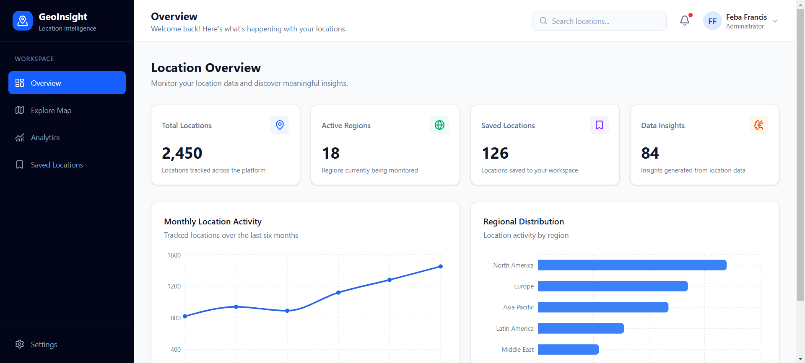
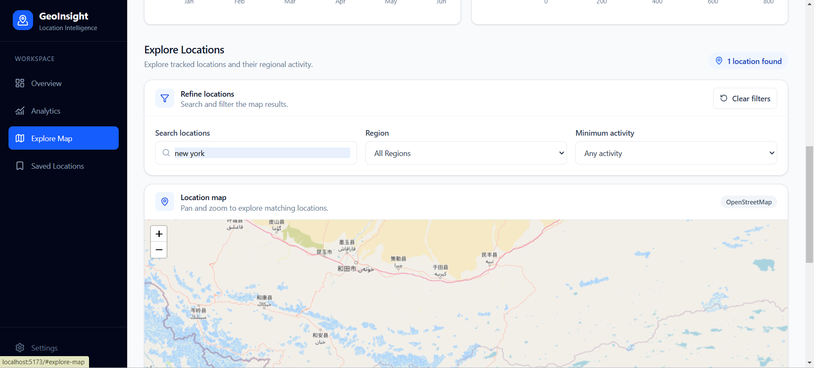

# GeoInsight

GeoInsight is a responsive location intelligence dashboard for exploring the project's sample locations, comparing regional activity, and managing saved places. The React frontend reads location and analytics data from a TypeScript/Express API. The API and frontend share the same dataset, preserving its original values.

## Features

- Dashboard metrics for total locations, active regions, saved locations, and total activity.
- Monthly activity and regional distribution charts.
- Interactive Leaflet map with search, region/activity filters, and location details.
- Saved locations persisted in browser localStorage.
- Responsive navigation and lazy-loaded Analytics and Explore Map sections.
- GeoInsight AI Assistant for questions grounded in the shared location and analytics dataset.
- Loading, empty, and error states for API-backed views.

The location and analytics values remain the project's sample dataset; no additional business metrics or live external data are introduced. OpenStreetMap provides map tiles.

## Application screenshots

| **Dashboard Overview** | **Analytics** |
| --- | --- |
| <br>Summary cards show location, region, saved-location, and activity metrics. | <br>Charts visualize monthly location activity and regional distribution. |
| **Explore Map** | **Saved Locations** |
| <br>The map combines location search, filters, and interactive markers. | <br>Saved places show location and activity details. |

## Technology

- **Frontend:** React, TypeScript, Vite, Tailwind CSS, Recharts, React Leaflet.
- **Backend:** Node.js, Express 5, TypeScript, Zod, local Ollama HTTP API, dotenv, CORS, and endpoint-specific rate limiting.
- **Testing:** Vitest, React Testing Library, Supertest, and Playwright.
- **Quality:** ESLint and TypeScript.

## Architecture

```text
.
├── shared/                      # Canonical location/analytics data and types
├── server/
│   ├── src/
│   │   ├── config/              # Environment validation
│   │   ├── controllers/          # HTTP request/response handlers
│   │   ├── middleware/           # Central not-found/error handling
│   │   ├── routes/               # API route registration
│   │   ├── schemas/               # Zod request schemas
│   │   ├── services/             # Dataset access and AI orchestration
│   │   └── app.ts, server.ts
│   └── tests/                    # Supertest API, AI, and error tests
├── src/
│   ├── app/                      # Dashboard layout and pages
│   ├── features/                 # Analytics, AI, dashboard, locations
│   ├── hooks/                    # Cancellable API resource hook
│   ├── services/                 # Frontend API client
│   └── test/                     # Frontend Vitest setup
├── e2e/                          # Playwright browser tests
├── playwright.config.ts
└── package.json
```

For an API-backed view, the frontend service requests the configured API URL. Express routes validate requests and pass them to controllers; services read and filter the canonical files in `shared/data/`. Errors flow through centralized middleware and return safe JSON responses. Frontend requests use `AbortController` cleanup to prevent stale responses from replacing newer results. Saved IDs continue to be stored locally; they are resolved against locations after the API data loads.

## API

All endpoints are prefixed with `/api`.

| Method | Path | Description |
| --- | --- | --- |
| `GET` | `/health` | Returns `{ "status": "ok" }`. |
| `GET` | `/locations` | Returns the location array. Optional query parameters: `search` (city or country substring), `region` (exact match), `minActivity` (non-negative integer). |
| `GET` | `/locations/:id` | Returns one location or a `404` error. |
| `GET` | `/analytics/monthly-activity` | Returns monthly chart data. |
| `GET` | `/analytics/regional-distribution` | Returns regional chart data. |
| `POST` | `/ai/insights` | Generates a dataset-grounded answer. Body: `{ "question": "Which region has the highest activity?" }`. |

AI questions must be non-empty and no longer than 500 characters. The endpoint returns `{ "success": true, "answer": "..." }`; validation errors return `400`, Ollama or model availability errors return `503`, and the AI endpoint is independently rate limited. Provider errors are mapped to safe responses without exposing provider details.

## GeoInsight AI Assistant

The dashboard's **AI Insights** section sends a question to `POST /api/ai/insights`. Express validates and rate-limits the request. The AI service builds a compact context from the existing location and analytics services (dataset totals, locations with activity counts and regions, monthly activity, and regional distribution), then sends it to the local Ollama `/api/chat` endpoint. The system instructions treat both question and data as untrusted content, require answers to use only supplied figures, and distinguish observations from recommendations. The frontend communicates only with Express; questions and responses are not persisted or sent to an external AI service.

Ollama is the default and only configured AI provider. The default model is `qwen2.5:3b`; the backend applies a request timeout and the existing per-IP rate limit. `OLLAMA_BASE_URL` is restricted to loopback addresses to keep location data on the local machine. No OpenAI API key or OpenAI SDK is used.

### Install and run local AI on Windows

1. Install Ollama for Windows from [ollama.com/download](https://ollama.com/download).
2. Open PowerShell and download the model (if it is not already installed):

   ```powershell
   ollama pull qwen2.5:3b
   ```

3. Start the Ollama Windows application. It normally runs in the background. If it is not running, start the local server in a separate PowerShell window:

   ```powershell
   ollama serve
   ```

4. Create `server/.env` from the example only if it does not already exist. In PowerShell:

   ```powershell
   if (-not (Test-Path server/.env)) {
     Copy-Item server/.env.example server/.env
   }
   ```

   If `server/.env` already exists, preserve its contents and add or update these settings rather than replacing the file:

   ```env
   AI_PROVIDER=ollama
   OLLAMA_BASE_URL=http://127.0.0.1:11434
   OLLAMA_MODEL=qwen2.5:3b
   ```

5. In the project directory, install dependencies and start GeoInsight:

   ```powershell
   npm.cmd install
   npm.cmd --prefix server install
   npm.cmd run dev:full
   ```

   Open `http://127.0.0.1:5173`, then choose **AI Insights**, select an example question or enter your own, and click **Ask AI**. Ollama must remain running while you use the assistant.

Common troubleshooting:

- **Ollama is unavailable:** Start the Ollama app or run `ollama serve`; check that `http://127.0.0.1:11434` is reachable.
- **Model unavailable:** Run `ollama list` and confirm `qwen2.5:3b` is listed. If needed, run `ollama pull qwen2.5:3b`.
- **Request times out:** The first response can take longer while the model loads. Retry after Ollama has finished loading the model.
- **Environment validation fails:** Check that `AI_PROVIDER=ollama`, and that `OLLAMA_BASE_URL` uses `http://localhost`, `http://127.0.0.1`, or the IPv6 loopback address. Restart the backend after editing `server/.env`.

This loopback Ollama setup is for local development. Deploying GeoInsight to a cloud host does not make your Windows computer's Ollama instance available to the cloud backend: `127.0.0.1` there refers to the cloud host itself. The current backend intentionally accepts only loopback Ollama URLs, so cloud use requires a separately designed and secured Ollama deployment; do not expose the Ollama API directly to the public internet.

## Install and run locally

Prerequisites: a Node.js version supported by the installed Vite release and npm.

```sh
npm install
npm --prefix server install
```

The server environment file setup is described above. If you need a root frontend `.env`, create it only when one does not already exist:

```powershell
if (-not (Test-Path .env)) {
  Copy-Item .env.example .env
}
```

By default, the API listens on `http://127.0.0.1:3000`, allows the local frontend origins `http://localhost:5173` and `http://127.0.0.1:5173`, and the frontend calls `http://127.0.0.1:3000/api`. Configure the server with `PORT` and `FRONTEND_ORIGIN` in `server/.env`. Configure the frontend API URL with `VITE_API_BASE_URL` in the root `.env`. CORS allows the configured origin and its localhost/127.0.0.1 equivalent only.

Start both development servers:

```sh
npm run dev:full
```

The frontend is available at `http://127.0.0.1:5173`. To run either service separately, use `npm run dev` (frontend) or `npm run dev:server` (backend). To build/start the backend, use `npm run build:server`, then `npm --prefix server start`.

## Testing

### Testing stack

- **Vitest** runs the frontend tests in jsdom (configured in `vite.config.ts`) and the backend tests in Node (configured in `server/vitest.config.ts`).
- **React Testing Library** renders frontend components and hooks and exercises their accessible UI behavior.
- **Supertest** sends requests to the Express app in backend API, AI, and error-handler tests.
- **Playwright** runs full browser workflows in Chromium. Its configuration starts the Vite frontend and Express backend; the AI E2E test mocks the insight endpoint.

### Commands

Run these from the repository root in Windows PowerShell:

| Purpose | Command |
| --- | --- |
| Frontend tests | `npm.cmd run test:frontend` |
| Backend tests | `npm.cmd run test:backend` |
| End-to-end tests | `npm.cmd run test:e2e` |
| Lint | `npm.cmd run lint` |
| Frontend type-check and production build | `npm.cmd run build` |
| Backend TypeScript build | `npm.cmd run build:server` |

Install Playwright's Chromium browser once if it is not already available:

```powershell
npx.cmd playwright install chromium
```

### Scenarios covered

- **Frontend:** dashboard summary metrics; location filtering by search, region, and minimum activity; controlled filter inputs and clearing; saved-location display/removal and localStorage persistence/invalid-data handling; AI Assistant examples, loading, duplicate-submit prevention, answer rendering, errors, and retry.
- **Backend:** health and CORS behavior; location listing, lookup, filtering, and invalid input; analytics endpoints; AI prompt/context and successful Ollama response, safe provider/model/timeout/invalid-response handling, question validation, and rate limiting; safe handling of unexpected API errors.
- **E2E:** dashboard metrics; navigation among Analytics, Explore Map, and Saved Locations; map search and filters; saving and removing a location; mobile navigation; and the AI Assistant request/answer flow with a mocked API response.

Latest verified counts from the commands above: **36 frontend tests across 6 files, 24 backend tests across 3 files, and 6 Playwright E2E tests**. These are test counts, not coverage percentages.

No coverage command or coverage provider is currently configured. Adding coverage reporting could help track gaps or enforce thresholds if the project adopts that goal; it is not needed for the current checks, so no dependency was added.

The browser suite aborts external map-tile requests so it does not depend on third-party tile availability. For additional Playwright details, see [e2e/README.md](./e2e/README.md).

## Implemented and future work

**Implemented:** the local-data REST API, frontend API integration, request validation, safe error handling, development CORS configuration, the server-only Ollama integration, AI rate limiting, backend/frontend/E2E tests, and local development scripts.

**Future work:** integration with live external location data providers and production deployment. The assistant analyzes only the current GeoInsight dataset and sends its context only to the local Ollama service.
