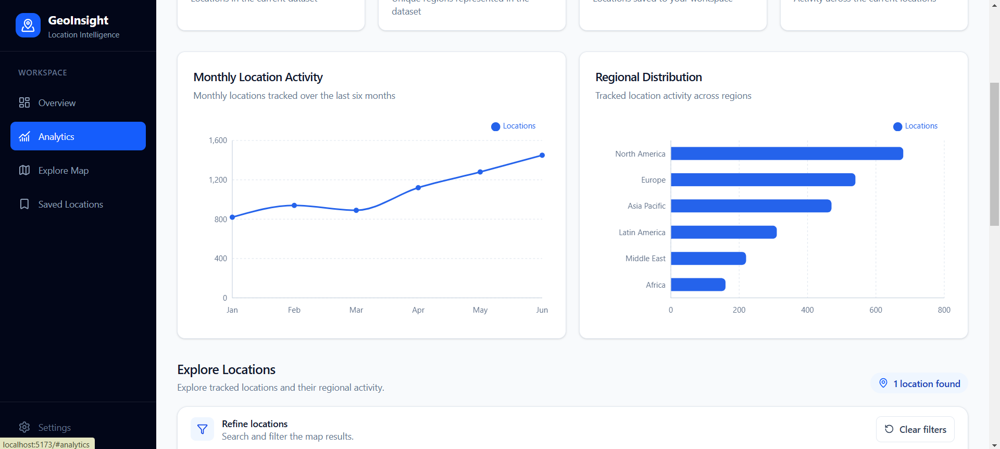
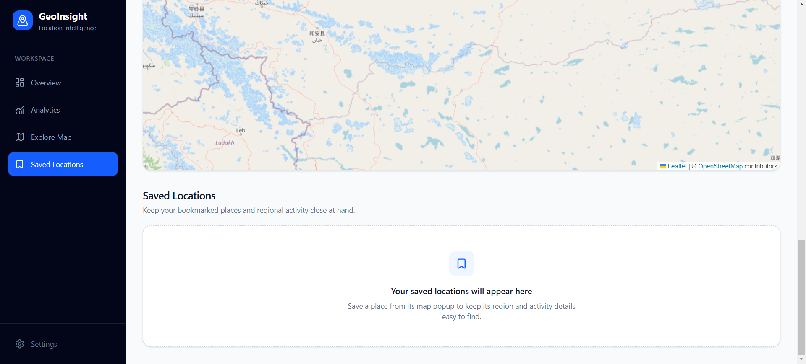

# GeoInsight

GeoInsight is a responsive location intelligence dashboard for exploring locations, comparing regional activity, and managing saved places. The current application uses a local sample dataset. A backend, live data APIs, and AI-generated insights are planned, but are not implemented.

## Features

- **Dashboard metrics:** total locations, unique active regions, saved locations, and total activity.
- **Analytics:** monthly location activity line chart and regional distribution bar chart.
- **Explore map:** interactive Leaflet map with location markers and popup details.
- **Search and filters:** search by city or country, filter by region and minimum activity, and clear filters.
- **Saved locations:** save locations from map popups, remove them from the saved list, and persist saved IDs in localStorage.
- **Responsive navigation:** desktop and tablet sidebar layouts, plus a mobile navigation drawer.
- **Deferred sections:** Analytics and Explore Map load when they approach the viewport.

The location and analytics values are sample data. Map tiles are provided by OpenStreetMap.

## Application Screenshots

| **Dashboard Overview** | **Analytics** |
| --- | --- |
| <br>Summary cards show location, region, saved-location, and activity metrics. | <br>Charts visualize monthly location activity and regional distribution. |
| **Explore Map** | **Saved Locations** |
| <br>The map view brings together location search, filters, and interactive markers. | <br>Saved places are presented with their location and activity details. |

## Technology Stack

- React and TypeScript
- Vite
- Tailwind CSS
- Recharts
- React Leaflet and Leaflet
- Lucide React
- Vitest, React Testing Library, jest-dom, and user-event
- Playwright Test
- ESLint

## Project Structure

```text
.
├── e2e/                         # Playwright browser tests and E2E notes
├── src/
│   ├── app/
│   │   ├── layouts/             # Dashboard shell, header, and sidebar
│   │   └── pages/               # Dashboard sections
│   ├── components/ui/           # Shared UI components
│   ├── features/
│   │   ├── analytics/           # Charts, data, and types
│   │   ├── dashboard/           # Summary cards, stats, and types
│   │   └── locations/           # Map, filters, saved locations, and data
│   ├── styles/                  # Global styles
│   └── test/                    # Vitest setup
├── playwright.config.ts
├── vite.config.ts
└── package.json
```

Unit, hook, and component tests are co-located with the relevant feature code.

## Getting Started

### Prerequisites

- Node.js and npm versions supported by the installed Vite version.

### Install and run

```sh
npm install
npm run dev
```

Open the local URL printed by Vite (by default, `http://localhost:5173`).
The current sample-data experience does not require API keys or environment
variables.

## Testing

### Vitest and React Testing Library

Vitest runs unit and component tests in jsdom. React Testing Library is used
to exercise components and hooks.

```sh
npm run test       # Watch mode
npm run test:run   # One-off run
```

### Playwright

Playwright runs end-to-end workflows in Chromium. Install the browser once if
it is not already available:

```sh
npx playwright install chromium
```

Then run the tests or open the interactive runner:

```sh
npm run test:e2e
npm run test:e2e:ui
```

The E2E suite starts the local Vite server automatically. Playwright writes an
HTML report that can be opened with:

```sh
npx playwright show-report
```

See [e2e/README.md](./e2e/README.md) for additional E2E details. Vitest tests
focus on isolated logic and UI behavior; Playwright tests exercise full
workflows in a real browser.

## Available Scripts

| Script | Description |
| --- | --- |
| `npm run dev` | Start the Vite development server. |
| `npm run build` | Type-check and create a production build. |
| `npm run preview` | Preview the production build locally. |
| `npm run lint` | Run ESLint. |
| `npm run test` | Run Vitest in watch mode. |
| `npm run test:run` | Run Vitest once. |
| `npm run test:e2e` | Run Playwright end-to-end tests. |
| `npm run test:e2e:ui` | Open Playwright's interactive UI mode. |

## Future Enhancements

These are planned and are not part of the current implementation:

- Add a backend API for location and analytics data.
- Replace the sample dataset with real, API-provided data.
- Add secure, server-side AI integration for location insights.
- Deploy the application and backend to a suitable hosting environment.
